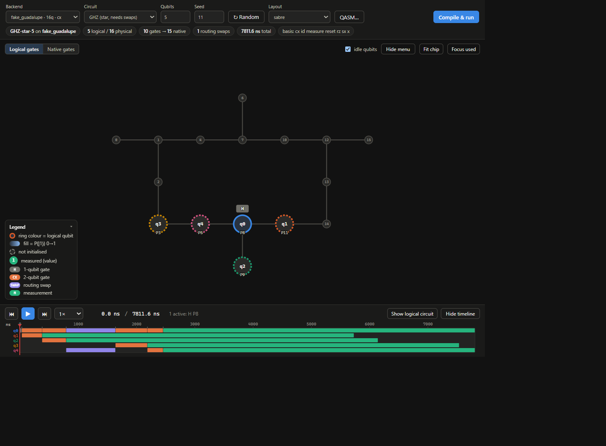

# QViz — Qiskit Circuit Visualiser

QViz is an interactive visualiser that maps a logical quantum circuit onto a
physical IBM backend and replays its execution over time.



## Requirements

- Python 3.10 or newer
- Qiskit 2.0 or newer

The standalone web application does not require Jupyter or IPython. Notebook
integration is available as an optional extra.

## Install from PyPI

Install the published package with:

```bash
python -m pip install qviz
```

To use the notebook helpers, install the optional notebook dependencies:

```bash
python -m pip install "qviz[notebook]"
```

For a source checkout, clone the repository and install it in editable mode:

```bash
git clone https://github.com/YOUR_USERNAME/circuit_visualiser.git
cd circuit_visualiser
python -m pip install -e .
```

Install development tools when running tests or building releases:

```bash
python -m pip install -e ".[dev]"
```

## Run the web application

After installation, start the application with:

```bash
qviz
```

Then open the printed URL, normally
<http://127.0.0.1:5000/>. You can choose a different address or port:

```bash
qviz --host 127.0.0.1 --port 8000
```

When running directly from a source checkout, the legacy server entry point is
also available:

```bash
python server.py
```

The equivalent module command is:

```bash
python -m qviz
```

## Use as a Python library

The compiler can be used without a notebook:

```python
from qiskit import QuantumCircuit
from qiskit_ibm_runtime.fake_provider import FakeManilaV2
from qviz import compile_circuit

circuit = QuantumCircuit(3)
circuit.h(0)
circuit.cx(0, 1)

model = compile_circuit(circuit, FakeManilaV2())
```

`compile_circuit` returns the JSON-serialisable model used by the web
application.

### Notebook integration

After installing `qviz[notebook]`, fixed and interactive notebook displays are
available:

```python
from qviz import display, interactive

display(circuit, FakeManilaV2())  # fixed circuit/backend viewer
interactive()                     # editable QViz workspace
```

`display` starts a local, temporary web server and returns an
`IPython.display.IFrame`; its circuit and backend controls are locked to the
values supplied by the caller. Both display modes work in `.ipynb` files
without a separate terminal process. The server thread is a daemon and ends
with the notebook kernel.

## Run tests

Install the development dependencies, then run:

```bash
python -m pytest
```

## Build and publish

From the project directory, install the development tools and build the source
distribution and wheel:

```bash
python -m pip install -e ".[dev]"
python -m build
```

The files will be created in `dist/`. Check them before uploading:

```bash
python -m twine check dist/*
```

Upload first to TestPyPI:

```bash
python -m twine upload --repository testpypi dist/*
```

After testing the TestPyPI package, upload the same artifacts to PyPI:

```bash
python -m twine upload dist/*
```

Every release needs a new version in `pyproject.toml`. Do not reuse a version
that has already been uploaded. Configure a PyPI API token through Twine's
standard configuration or environment variables; do not put the token in the
repository.

## Publish the source to GitHub

Create an empty repository on GitHub, then run these commands from the project
directory:

```bash
git init
git add .
git commit -m "Initial commit"
git branch -M main
git remote add origin https://github.com/YOUR_USERNAME/circuit_visualiser.git
git push -u origin main
```

Ensure that `.gitignore` excludes virtual environments, caches, build outputs,
logs, and credentials before pushing.

## What you see

| Area | Content |
|------|---------|
| **Backend view** | Physical qubits, routing swaps, native gates, state probabilities, measurements, and backend properties. |
| **Inspector** | Logical and physical qubit details, Bloch vectors, position history, gate definitions, durations, and errors. |
| **Timeline** | Scheduled gates and controls for playing, pausing, seeking, and changing playback speed. |
| **Logical circuit** | The original circuit, execution tracking, and links between logical and physical views. |
| **Logical / Native gates** | Gates as written or translated to the backend basis with hardware durations. |

Circuits using more than 16 physical qubits are not statevector-simulated, but
their gates, timing, and qubit positions are still displayed.

## How it works

1. The circuit is flattened and multi-qubit gates are expanded where needed.
2. Qiskit routes the circuit to the backend coupling map.
3. Routed gates are translated to the backend basis and scheduled ASAP.
4. Native operations are simulated when the active circuit fits within the
   16-qubit statevector limit.

## Project layout

```text
qviz/
  engine.py       compile, route, schedule, and simulate
  layout.py       physical qubit coordinates
  circuits.py     example circuits and QASM loading
  schema.py       gate schema data
  web.py          Flask application factory and API
  notebook.py     Jupyter display helpers
  cli.py          installed qviz command
  static/         packaged web UI assets
tests/            regression tests
pyproject.toml    package metadata and build configuration
```
